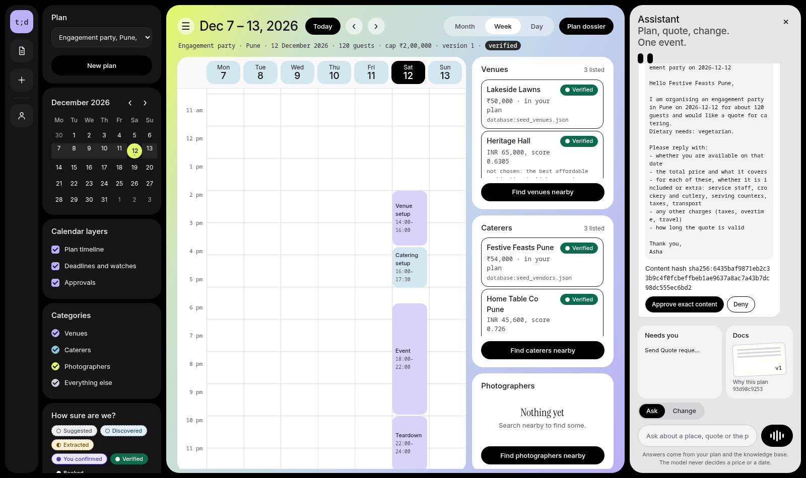
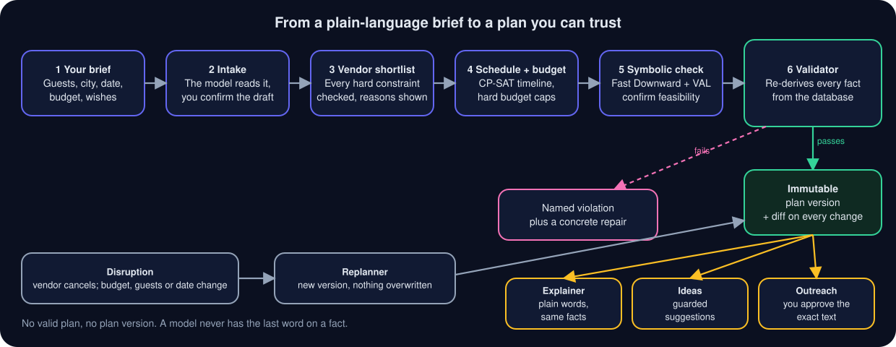
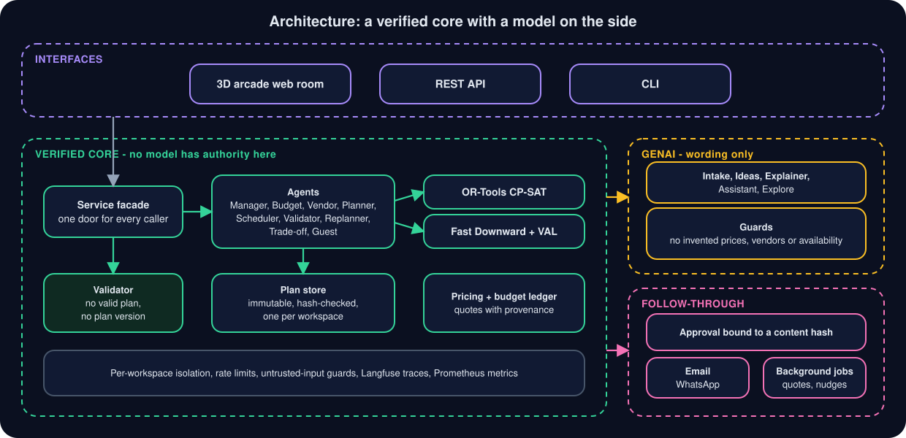

<p align="center">
  <picture>
    <source media="(prefers-color-scheme: dark)" srcset="docs/assets/logo-dark.svg">
    
  </picture>
</p>

<p align="center"><b>Tell it about your event. Get a plan you can trust.</b><br>A GenAI-powered planning assistant for weddings, birthdays and community events: budgets, timelines, vendor checklists and personalised ideas, checked by solvers instead of guessed by a model.</p>

<p align="center">
<a href="https://github.com/TheManishCode/to_doh_the_event_planner/actions/workflows/ci.yml"></a>


</p>

<p align="center"><a href="https://todoh.manishp.dev"><b>Live demo</b></a> &nbsp;·&nbsp; <a href="#try-it-in-60-seconds">Quick start</a> &nbsp;·&nbsp; <a href="#how-it-works">How it works</a> &nbsp;·&nbsp; <a href="docs/DEMO.md">5-minute tour</a> &nbsp;·&nbsp; <a href="#problem-statement-coverage">Problem-statement map</a></p>

<p align="center"></p>

## Why to;doh

Asking a chatbot to plan a wedding gets you confident prices that do not exist and a budget that does not add up. **to;doh** splits the job the way a good planner would:

- **The model talks.** It reads your messy brief, suggests ideas that fit *your* event, and explains the result in plain words.
- **The software decides.** A constraint solver builds the schedule, a second validator re-derives every fact from the vendor database, and a plan that fails a hard rule is never shown. It comes back with the rule it broke and how to fix it.
- **You stay in control.** Nothing is sent to a vendor until you approve the exact text.

## Problem statement coverage

*Create a GenAI-powered planning assistant that helps users organize weddings, birthdays, and community events with budgets, timelines, vendor checklists, and personalized ideas.*

| Requirement | Implementation | Tests |
|---|---|---|
| GenAI-powered assistant | `eventmate/assistant/`, `eventmate/agents/manager.py`, versioned `prompts/`; models phrase, code and data decide facts | `tests/test_assistant.py`, `tests/test_idea_guard.py` |
| Weddings, birthdays, community events | `EventType` in `eventmate/schemas.py`; `eventmate/planning/community.py` with `eventmate/data/community_profiles.json`; event-neutral vendor and deal queries | `tests/test_community.py`, `tests/test_intake_community.py`, `tests/test_deals.py` |
| Budgets | `eventmate/agents/budget.py`, `eventmate/pricing/reality.py`, `eventmate/pricing/ledger.py` | `tests/test_budget.py` |
| Timelines | `eventmate/agents/scheduler.py` (CP-SAT) and `eventmate/agents/planner.py` (PDDL cross-check) | `tests/test_scheduler.py`, `tests/test_planner.py` |
| Vendor checklists | `eventmate/agents/vendor.py`, `eventmate/agents/validator.py`, `eventmate/messaging/` | `tests/test_vendor.py`, `tests/test_validator.py`, `tests/test_conversations.py` |
| Personalized ideas | `eventmate/planning/ideas.py`: templates need no model; model ideas pass a guard | `tests/test_ideas.py`, `tests/test_idea_guard.py` |
| Organize over time | `eventmate/agents/replanner.py`, `eventmate/plan_store.py`, `eventmate/followthrough/` | `tests/test_replanning.py`, `tests/test_plan_store.py` |

## What it does

|  |  |
|---|---|
| 💸 **Budgets** | A split with a contingency reserve, a reality check before you start, and ranked trade-offs when money is tight |
| 🗓️ **Timelines** | A schedule with buffers, built by CP-SAT and cross-checked symbolically with Fast Downward and VAL |
| ✅ **Vendor checklists** | A shortlist per category with the reason behind every pick, and outreach you approve word for word |
| ✨ **Personalised ideas** | Themes, activities and menu notes drawn from your event's facts, labelled as suggestions, never as verified offers |
| 🎉 **Weddings, birthdays, community events** | Each has its own profile. Community events add attendance, funding, volunteer, permit and accessibility checks |
| 🔁 **When plans change** | Cancel a vendor or change the budget, guest count or date: you get a new version and a diff, and confirmed bookings are kept |

## Try it in 60 seconds

```sh
python -m venv .venv && . .venv/bin/activate
pip install -e ".[dev]"
cp .env.example .env && chmod 600 .env      # optional: add a model key for the GenAI features
python -m eventmate.web                     # open http://127.0.0.1:8765 (the dashboard is at /app)
```

Then type something like *"120-person engagement party in Pune on December 12, under INR 200,000, vegetarian catering, indoor venue, photographer."* Prefer a terminal?

```sh
python -m eventmate plan "120-person engagement party in Pune on December 12 under INR 200,000. Vegetarian catering, indoor venue, photographer."
python -m eventmate show <plan_id>
python -m eventmate replan <plan_id> --cancel-vendor cat-pune-rasoi
```

Requires Python 3.12+. The symbolic timeline check uses [Fast Downward](https://www.fast-downward.org/) and [VAL](https://github.com/KCL-Planning/VAL) (`EVENTMATE_FD`, `EVENTMATE_VAL`, see [configuration](docs/CONFIGURATION.md)); without them plans still build and that check is shown as unavailable, never faked. With no model key, intake, ideas and explanations fall back to deterministic versions.

## How it works

<p align="center"></p>

<p align="center"></p>


## Built with

Python · Flask · Pydantic · Google OR-Tools (CP-SAT) · Fast Downward · VAL · NVIDIA and OpenRouter hosted models · Langfuse · Prometheus and Grafana · Docker.

## Trust, in four lines

- **No invented facts.** Prices, capacities, diets and booking status come from the database, from you, or from a tool.
- **Validated or not shown.** A plan version cannot exist unless every hard constraint passed an independent re-check.
- **Nothing leaves without approval.** Messages are bound to a hash of their exact text, and vendor replies are treated as untrusted data.
- **Stop requests are honoured, but not authenticated.** A stop request or a permanent delivery failure naming a message we sent puts an address on a do-not-contact list that only you can lift. That matching relies on mail headers that can be forged, so a forgery can only stop us writing to an address we already wrote to, and a bounced address shows why it failed before you can re-enable it. to;doh does not check anti-spam or privacy law: check the rules that apply to you before contacting businesses.

## Status

A working prototype built for a hackathon. Vendor data is synthetic seed data for nine cities, and email has been tested against fake SMTP and IMAP only. The landing page (`/`) and the dashboard (`/app`) are the front end; the REST API and CLI drive the same engine.

## Documentation

| | |
|---|---|
| [docs/DEMO.md](docs/DEMO.md) | a five-minute walkthrough |
| [docs/CONFIGURATION.md](docs/CONFIGURATION.md) | environment variables, API keys, optional integrations |
| [docs/EMAIL_SETUP.md](docs/EMAIL_SETUP.md) | mailbox setup, limits, how to stop everything |
| [docs/HOSTING.md](docs/HOSTING.md) · [docs/RUNBOOK.md](docs/RUNBOOK.md) · [deploy/](deploy/) | run it for other people: container, compose stack, alerts, backups |
| [docs/eventmate_architecture.md](docs/eventmate_architecture.md) | architecture |
| [docs/PRIVACY.md](docs/PRIVACY.md) · [SECURITY.md](SECURITY.md) | privacy and reporting a vulnerability |
| [docs/ATTRIBUTIONS.md](docs/ATTRIBUTIONS.md) | licences of the fonts and the ideas taken from open-source projects |

## Contributing

See [CONTRIBUTING.md](CONTRIBUTING.md). Every change ships with tests, including at least one adversarial test for each new input surface.
