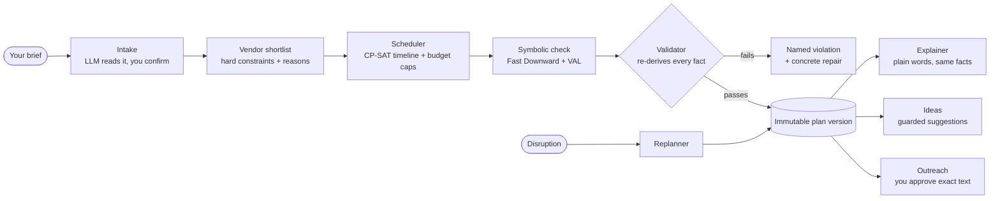
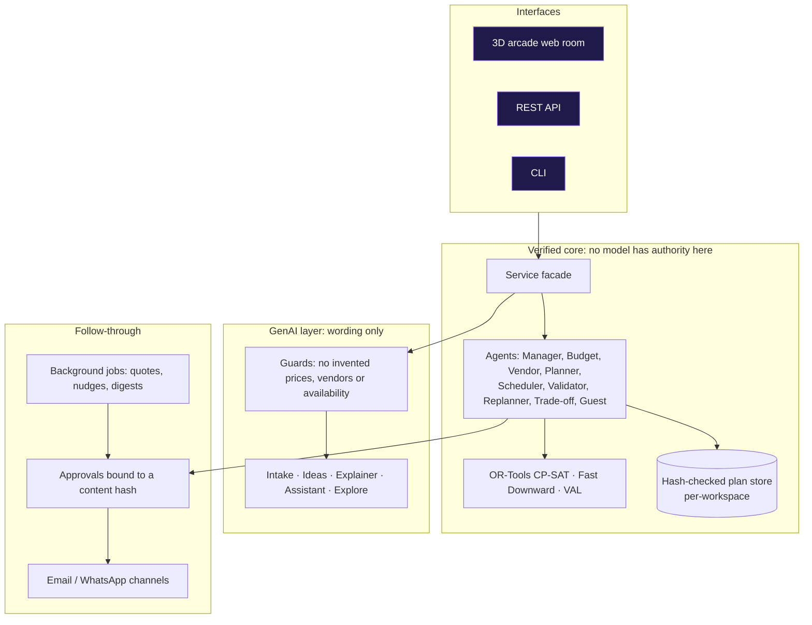

<p align="center"></p>

<h3 align="center">A GenAI-powered planning assistant for weddings, birthdays and community events.<br>Budgets, timelines, vendor checklists and personalised ideas, with every plan checked by solvers instead of trusted to a model.</h3>

<p align="center">
<a href="https://github.com/TheManishCode/to_doh_the_event_planner/actions/workflows/ci.yml"></a>


</p>

<p align="center"><a href="https://todoh.manishp.dev">Live demo</a> · <a href="#quick-start">Quick start</a> · <a href="#how-it-works">How it works</a> · <a href="docs/DEMO.md">5-minute tour</a> · <a href="docs/PROBLEM_STATEMENT.md">Problem-statement map</a></p>

---

## The idea

Planning an event means juggling a budget, a schedule, a pile of vendors and a hundred small decisions, and a chatbot that confidently invents prices does not help. **to;doh** lets you describe the event in plain words. A language model helps with *wording* (reading your brief, suggesting ideas, explaining the result). **Facts and feasibility come from code**: a constraint solver builds the schedule, a second validator re-derives every claim from the database, and nothing is sent to a vendor without your approval.

> *"Plan a 120-person engagement party in Pune on December 12 under INR 200,000. Vegetarian catering, indoor venue, photographer."*
> → a validated plan with a budget split, a timeline, a vendor checklist with reasons, alternatives, and ideas to make it yours.

## What you get

| You ask for | You get |
|---|---|
| **Budgets** | An allocation with a contingency reserve, an up-front reality check, a live ledger, and ranked trade-off options when money is tight |
| **Timelines** | A CP-SAT schedule with buffers, cross-checked symbolically (Fast Downward + VAL) |
| **Vendor checklists** | A shortlist per category with every hard constraint and reason shown; vendor outreach you approve word for word |
| **Personalised ideas** | Themes, activities and menu notes from the facts of *your* event, labelled as suggestions and never as verified offers |
| **Weddings, birthdays, community events** | Event-type profiles; community events add attendance, funding, volunteer, permit and accessibility checks |
| **Change of plans** | Cancel a vendor or change the budget, guest count or date: a new plan version and a diff, with confirmed bookings preserved |

## How it works



### Architecture



Where the model sits, what it may see and what stops it going wrong: [docs/GENAI.md](docs/GENAI.md). Every design decision: [docs/DECISIONS.md](docs/DECISIONS.md).

## Guarantees

Each of these is enforced in code and covered by tests.

- **No invented facts.** Prices, capacities, diets and booking status come from the database, you, or a tool. A model may phrase or propose; it never sources a fact.
- **Validated or not shown.** A plan version cannot exist unless every hard constraint passed an independent re-check, and a failure names the constraint and a repair.
- **Nothing leaves without approval.** Vendor messages are bound to a hash of their exact text; replies are treated as untrusted data.
- **Stop requests are honoured, but not authenticated.** A stop request or a permanent delivery failure that names a message we sent puts an address on a do-not-contact list that only you can lift. That matching relies on mail headers that can be forged, so a forgery can only stop us writing to an address we already wrote to, and a bounced address shows why it failed before you can re-enable it. to;doh does not check anti-spam or privacy law: check the rules that apply to you before contacting businesses.
- **Nothing is overwritten.** Every replan writes a new immutable version and a diff.
- **Honest about gaps.** A need that cannot be checked from data is marked *Needs verification*, never called verified.

## Quick start

Requires Python 3.12+.

```sh
python -m venv .venv && . .venv/bin/activate
pip install -e ".[dev]"
cp .env.example .env && chmod 600 .env     # optional: add a model key (NVIDIA / OpenRouter) for the GenAI features
python -m eventmate.web                    # http://127.0.0.1:8765
```

Or from the command line:

```sh
python -m eventmate plan "Plan a 120-person engagement party in Pune on December 12 under INR 200,000. Vegetarian catering, indoor venue, photographer."
python -m eventmate show <plan_id>
python -m eventmate replan <plan_id> --cancel-vendor cat-pune-rasoi
```

The symbolic timeline check needs [Fast Downward](https://www.fast-downward.org/) and [VAL](https://github.com/KCL-Planning/VAL) (`EVENTMATE_FD`, `EVENTMATE_VAL`; see [docs/CONFIGURATION.md](docs/CONFIGURATION.md)). Without them plans still build, and the check is shown as unavailable rather than faked. With no model key, intake, ideas and explanations fall back to deterministic versions. The full-quality 3D models can be served from a bucket with `EVENTMATE_ASSET_BASE`; without it the room uses the light models in the repository.

## Status

A working prototype, built for a hackathon. Vendor data is synthetic seed data (nine cities), and email has been tested against fake SMTP/IMAP only. The 3D room is the front end; the REST API and CLI expose the same engine.

## Documentation

| Start here | |
|---|---|
| [docs/DEMO.md](docs/DEMO.md) | a five-minute walkthrough |
| [docs/CONFIGURATION.md](docs/CONFIGURATION.md) | environment variables, API keys, optional integrations |
| [docs/HOSTING.md](docs/HOSTING.md) · [docs/RUNBOOK.md](docs/RUNBOOK.md) · [deploy/](deploy/) | run it for other people: container, compose stack, alerts, backups |
| [docs/EMAIL_SETUP.md](docs/EMAIL_SETUP.md) | mailbox setup, limits, how to stop everything |

| Understand it | |
|---|---|
| [docs/eventmate_architecture.md](docs/eventmate_architecture.md) · [docs/DECISIONS.md](docs/DECISIONS.md) | architecture and every decision record |
| [docs/GENAI.md](docs/GENAI.md) · [docs/MODEL_INPUTS.md](docs/MODEL_INPUTS.md) | where a model is used and what it may see |
| [docs/PRIVACY.md](docs/PRIVACY.md) · [SECURITY.md](SECURITY.md) · [docs/SECURITY_FINDINGS.md](docs/SECURITY_FINDINGS.md) | privacy, reporting a vulnerability, what was attacked and fixed |
| [docs/PERFORMANCE.md](docs/PERFORMANCE.md) | measured server and asset numbers |
| [docs/ROADMAP.md](docs/ROADMAP.md) | built, deferred and rejected |
| [docs/RELEASE.md](docs/RELEASE.md) | release notes and decisions before going public |
| [docs/ATTRIBUTIONS.md](docs/ATTRIBUTIONS.md) | licences of the 3D models and libraries |

## Contributing

See [CONTRIBUTING.md](CONTRIBUTING.md). Every change ships with tests, including at least one adversarial test for each new input surface.
